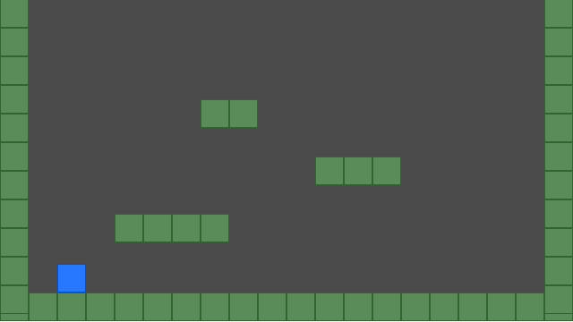

# Plataformas1

Mi primer juego de plataformas en **GameMaker** (GML): un cuadrado azul que camina, salta y choca con paredes y plataformas, con gravedad y colisiones píxel a píxel.



## Controles

| Acción | Teclas |
|---|---|
| Caminar | Flechas ← → o **A** / **D** |
| Saltar (solo en el suelo) | **Espacio**, flecha ↑ o **W** |

## Qué tiene

- **Gravedad**: el jugador cae y solo puede saltar cuando está en el suelo.
- **Colisiones píxel a píxel** con las paredes y plataformas (`obj_pared`), tanto horizontales como verticales.
- **Reaparece al inicio** si se cae fuera de la sala.

## Estructura

```
Plataformas1.yyp            proyecto de GameMaker
sprites/spr_jugador         cuadrado azul 32x32
sprites/spr_pared           bloque verde 32x32
objects/obj_jugador         Create_0.gml (variables) y Step_0.gml (movimiento, salto, gravedad, colisiones)
objects/obj_pared           bloque sólido, sin código
rooms/rm_prueba             sala de 640x360 con suelo, paredes laterales y 3 plataformas
```

El código en `objects/obj_jugador/` está comentado en español, paso a paso.

## Cómo abrirlo

1. Instala **GameMaker** (lo hice con la versión beta 2026.100).
2. Clona o descarga este repositorio.
3. En GameMaker: **Open** y elige `Plataformas1.yyp`.
4. Pulsa **Run** (F5) para jugar.

## Próximo

- Monedas con puntaje.
